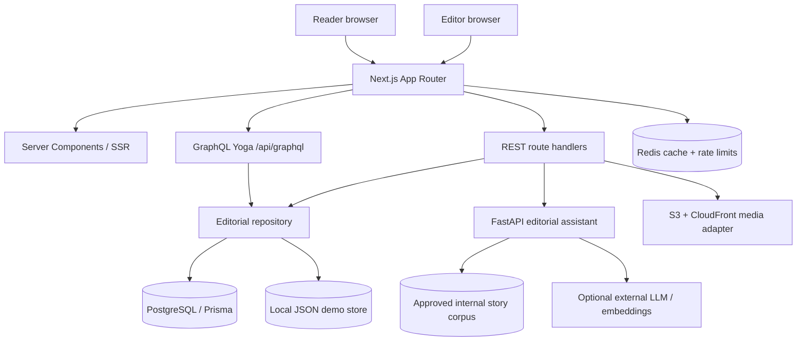

# EDITION architecture

## Product boundary

EDITION is a single editorial platform serving two publication identities. Publication identity is data/configuration (`src/lib/brands.ts`) rather than a second application. Reader routes are brand-scoped; operational studio routes share one editorial workspace.

## Runtime topology

## Rendering strategy

- Publication home, article, category, tag and author pages are Server Components. They fetch editorial data on the server and send only the markup required for the reader experience.
- `revalidate = 300` is used on reader-facing publication and article routes. Explicit editorial cache invalidation is available when repository writes complete.
- Client Components are reserved for interactions that need browser state: navigation controls, search, gallery navigation, save-story state, reading progress, the CMS editor/dashboard, and the AI workbench.
- `Suspense` provides a boundary for related-story discovery; the article remains readable while recommendations resolve.
- Images use `next/image`, explicit responsive `sizes`, `priority` on the lead image, and lazy loading by default elsewhere.

## Content and API strategy

- PostgreSQL is the durable source of truth when `EDITION_USE_DB=true`. The API fails closed on configured database failures rather than silently writing editorial mutations into a local file store.
- Local JSON mode exists for a low-friction demo and unit/e2e setup. It is not a multi-instance production persistence layer.
- GraphQL is the reader-facing content query layer. Its article list is restricted to `PUBLISHED`; studio write workflows use authenticated REST route handlers.
- REST handles login/logout, CMS writes, media uploads, scheduled publishing, and the Node-to-FastAPI boundary.
- Prisma models publications, users, authors, articles, versions and media assets. The SQL migration in `prisma/migrations` is the deployable schema source.

## Authentication and editorial permissions

- Sessions use an HTTP-only, `SameSite=Lax` cookie signed with HS256. Production refuses an absent/short `SESSION_SECRET`.
- Database-backed mode authenticates persisted user records with Node's `scrypt` password hashes and timing-safe comparisons. The demo JSON mode uses configurable credentials and must not be exposed as a public production identity system.
- Authors can access/edit only articles assigned to their user ID. Editors/admins can review and publish. Server route handlers enforce permissions independently of the UI.
- Cookie-authenticated mutations enforce same-origin checks and login/assistant operations are rate limited. Redis is shared across instances when configured; the in-memory limiter is a local fallback only.

## AI service boundary

The Python service is a separate process. The web server authenticates service-to-service requests with `AI_SERVICE_TOKEN`. Demo mode returns deterministic, explicitly labelled output. Provider mode can call an external model and optional embedding endpoint. Internal source candidates are allow-listed and related IDs are validated against the known corpus. AI responses require human approval and there is no AI publishing endpoint.

## Media

Local demo uploads are stored under `public/uploads` with a local manifest. When `S3_MEDIA_BUCKET` and `MEDIA_BASE_URL` are configured, images are uploaded to a private S3 bucket and served from its CloudFront distribution; metadata is stored in Prisma when DB mode is enabled. Supported formats are JPEG, PNG and WebP; the server validates file signatures, MIME type and size.

## Deployment topology

`infra/aws/terraform` describes an ECS/Fargate deployment with an Application Load Balancer, PostgreSQL RDS, Redis/ElastiCache, private S3 media bucket + CloudFront, Secrets Manager and CloudWatch logs. It expects an existing VPC with public and private subnets and container images published to ECR. It is infrastructure-as-code, not evidence that an AWS environment has been provisioned.
